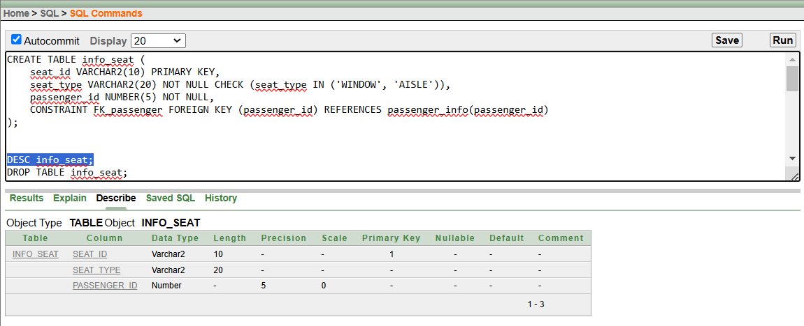
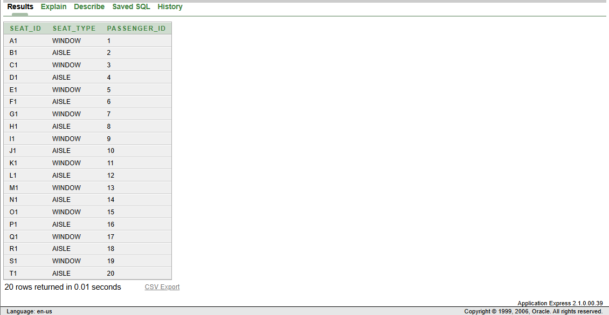
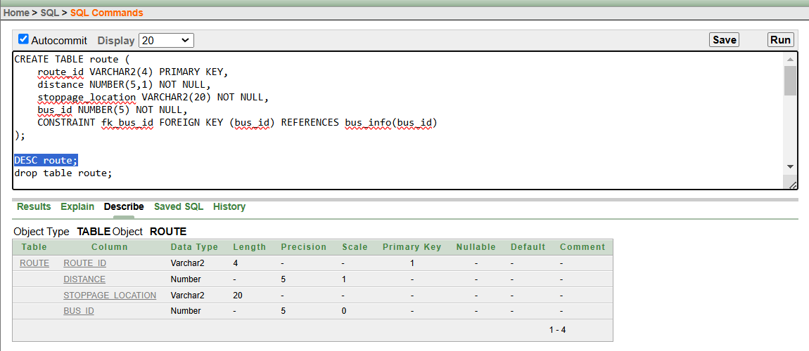
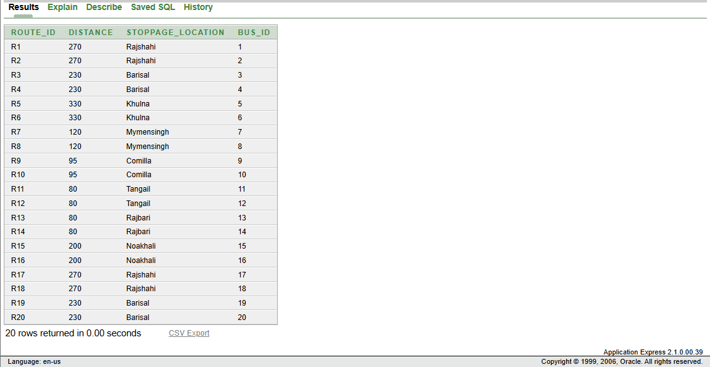
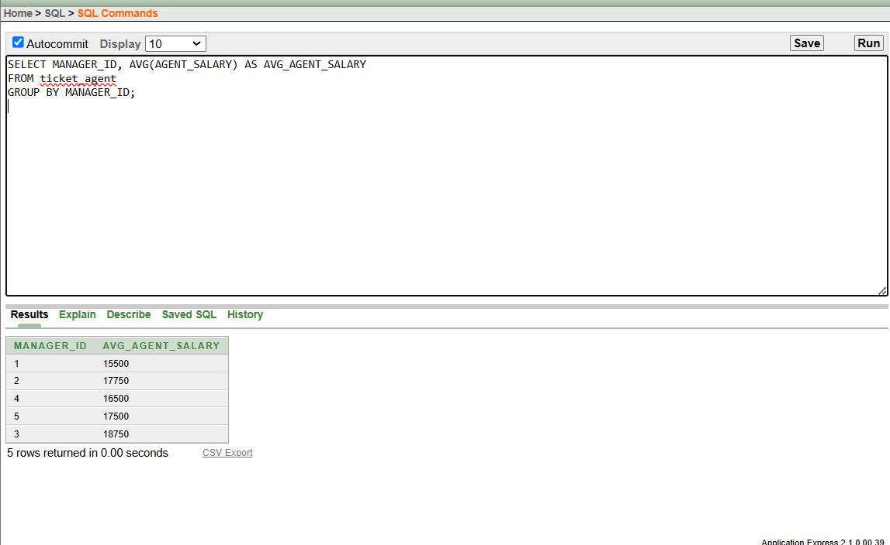
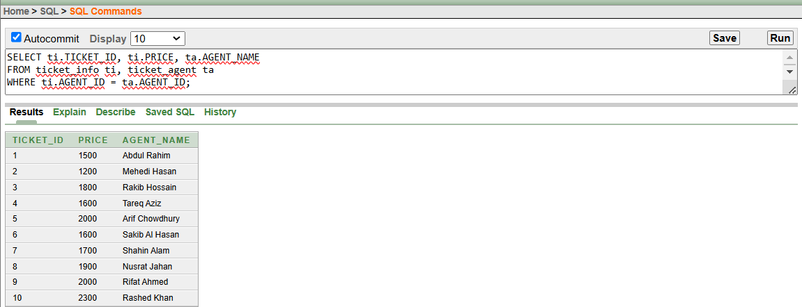
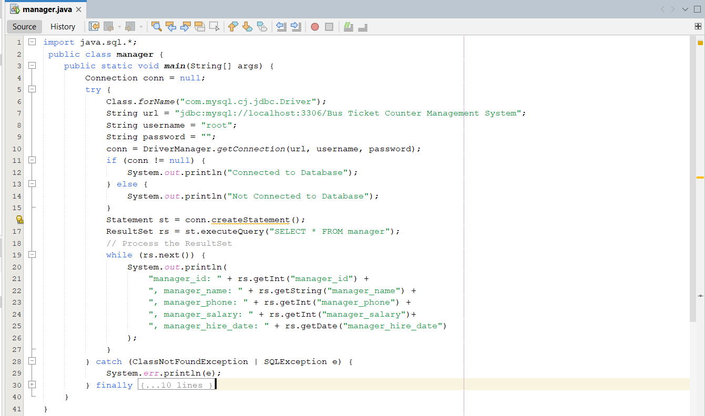

# Bus Ticket Counter Management System

A database project for the **Introduction to Database (CSC2108)** course at AIUB.
It stores the information of a bus ticket counter: managers, ticket agents, tickets,
customers, payments, passengers, seats, buses and routes.

The tables, data, queries and views were built in **Oracle**. The same database was also
created in **MySQL (XAMPP)** and connected to **Java** using JDBC.

## Features

- 9 related tables with primary keys, foreign keys, `CHECK`, `UNIQUE`, `NOT NULL` and `DEFAULT` constraints
- Sample data (145 rows in total)
- Test queries: simple query, single row function, aggregate function, subqueries, 4 types of joins
- One simple view and one complex view
- Java programs that connect to the database and print the tables

## Tables

| # | Table | What it stores | Foreign key |
|---|-------|----------------|-------------|
| 1 | `manager` | Managers | – |
| 2 | `ticket_agent` | Ticket agents | `manager_id` → manager |
| 3 | `ticket_info` | Tickets sold | `agent_id` → ticket_agent |
| 4 | `customer_info` | Customers who buy tickets | `ticket_id` → ticket_info |
| 5 | `payment_details` | Payments (30% off for NON AC) | `ticket_id` → ticket_info, `customer_id` → customer_info |
| 6 | `passenger_info` | Passengers | `customer_id` → customer_info |
| 7 | `info_seat` | Seats | `passenger_id` → passenger_info |
| 8 | `bus_info` | Buses | `passenger_id` → passenger_info |
| 9 | `route` | Routes / stoppages | `bus_id` → bus_info |

## Project Structure

```
DataBase-BusTicketCounterManagement/
├── database/
│   ├── oracle/
│   │   ├── 01_create_tables.sql      # create all 9 tables
│   │   ├── 02_insert_data.sql        # insert sample data
│   │   ├── 03_queries_and_views.sql  # test queries and views
│   │   └── 04_drop_tables.sql        # delete everything
│   └── mysql/
│       └── bus_ticket_counter_management_system.sql   # same database for XAMPP
├── java/
│   ├── src/        # DBConnection + one program for each table
│   └── lib/        # MySQL JDBC driver (.jar)
├── docs/           # project report (.docx) and ER diagram
└── screenshots/    # tables, queries and Java output
```

## Requirements

- **Oracle Database XE** (with Application Express or SQL Developer) – for the Oracle scripts
- **XAMPP** – download from [apachefriends.org](https://www.apachefriends.org/) (for MySQL + phpMyAdmin)
- **JDK 8 or newer** – download from [Adoptium](https://adoptium.net/)
- **VS Code** with the **Extension Pack for Java**, or NetBeans

## Clone the Project

```bash
git clone https://github.com/munshi-rishad/DataBase-BusTicketCounterManagement.git
```

## Setup

### Oracle

Open the SQL Commands page (or SQL Developer) and run the files in order:

1. `database/oracle/01_create_tables.sql`
2. `database/oracle/02_insert_data.sql`
3. `database/oracle/03_queries_and_views.sql`

To start again, run `04_drop_tables.sql` and then step 1 again.

### MySQL (XAMPP) + Java in VS Code

1. Open the **XAMPP Control Panel** and start **Apache** and **MySQL**.
2. Go to `http://localhost/phpmyadmin`, open the **SQL** tab, paste the whole
   `database/mysql/bus_ticket_counter_management_system.sql` file and click **Go**.
   This creates the database with all tables and data.
3. Open the project folder in VS Code.
4. In the **Java Projects** panel, click **+** next to **Referenced Libraries** and add
   `java/lib/mysql-connector-java-8.0.30.jar`.
5. Open any file in `java/src` (for example `ManagerTable.java`) and click **Run**.

Or run from the terminal inside the project folder:

```bash
javac -cp java/lib/mysql-connector-java-8.0.30.jar -d out java/src/*.java

# Windows
java -cp "out;java/lib/mysql-connector-java-8.0.30.jar" ManagerTable
# macOS / Linux
java -cp "out:java/lib/mysql-connector-java-8.0.30.jar" ManagerTable
```

Replace `ManagerTable` with `TicketAgentTable`, `TicketInfoTable` or `CustomerInfoTable` to see the other tables.

> **Note:** The database name, user (`root`) and password (empty) are set in
> `java/src/DBConnection.java`. Change them there if your MySQL setup is different.

## ER Diagram


## Screenshots

### Tables in Oracle

1. **manager**
   
   

2. **ticket_agent**
   
   

3. **ticket_info**
   
   

4. **customer_info**
   
   

5. **payment_details**
   
   

6. **passenger_info**
   
   

7. **info_seat**
   
   

8. **bus_info**
   
   

9. **route**
   
   

### Queries and Views

All query screenshots are in [`screenshots/queries`](screenshots/queries). A few examples:

- **Aggregate function** – average agent salary for each manager
  
- **Inner join** – each ticket with the agent who sold it
  

### Java Connection (XAMPP + MySQL)

- **Code**
  
- **Output**
  

More screenshots for each table are in [`screenshots/java`](screenshots/java).
