# Bus Ticket Counter Management System

A database project for the **Introduction to Database (CSC2108)** course at AIUB.
It stores the information of a bus ticket counter: managers, ticket agents, tickets,
customers, payments, passengers, seats, buses and routes.

The tables, data, queries and views were built in **Oracle**. The same database was also
created in **MySQL (XAMPP)** and connected to **Java** using JDBC.

**Semester:** Fall 2024-2025

## Features

- 9 related tables with primary keys, foreign keys, `CHECK`, `UNIQUE`, `NOT NULL` and `DEFAULT` constraints
- Sample data (135 rows in total)
- Test queries: simple query, single row function, aggregate function, subqueries, 4 types of joins
- One simple view and one complex view
- Java programs that connect to the database and print the tables

## Technologies Used

- Oracle Database (SQL, constraints, joins, subqueries, views)
- MySQL with XAMPP (phpMyAdmin)
- Java with JDBC (MySQL Connector/J 8.0.30)

## Database Tables

The database has **9 related tables**:

- **manager** – managers who supervise ticket agents
- **ticket_agent** – ticket agents (`manager_id` → manager)
- **ticket_info** – tickets sold by an agent (`agent_id` → ticket_agent)
- **customer_info** – customers who buy tickets (`ticket_id` → ticket_info)
- **payment_details** – payment of each customer, 30% off for NON AC (`ticket_id` → ticket_info, `customer_id` → customer_info)
- **passenger_info** – passengers travelling for a customer (`customer_id` → customer_info)
- **route** – destination and distance of each route
- **bus_info** – buses and the route they run on (`route_id` → route)
- **info_seat** – seat of each passenger on a bus (`passenger_id` → passenger_info, `bus_id` → bus_info)

## Project Structure

```
DataBase-BusTicketCounterManagement/
├── database/
│   ├── oracle/
│   │   ├── 01_create_tables.sql      # create all 9 tables
│   │   ├── 02_insert_data.sql        # insert sample data
│   │   ├── 03_queries_and_views.sql  # test queries and views
│   │   └── 04_drop_tables.sql        # delete everything
│   └── mysql/
│       └── bus_ticket_counter_management_system.sql   # same database for XAMPP
├── java/
│   ├── src/        # DBConnection + one program for each table
│   └── lib/        # MySQL JDBC driver (.jar)
├── docs/           # project report (.docx) and ER diagram
└── screenshots/    # tables, complex view and Java output
```

## Requirements

- **Oracle Database XE** (with Application Express or SQL Developer) – download from [oracle.com/downloads](https://www.oracle.com/downloads/)
- **XAMPP** – download from [apachefriends.org](https://www.apachefriends.org/) (for MySQL + phpMyAdmin)
- **JDK 8 or newer** – download from [Adoptium](https://adoptium.net/)
- **VS Code** with the **Extension Pack for Java**, or NetBeans

## Clone the Project

```bash
git clone https://github.com/munshi-rishad/DataBase-BusTicketCounterManagement.git
```

## Setup and Run

### Oracle

Open the SQL Commands page (or SQL Developer) and run the files in order:

1. `database/oracle/01_create_tables.sql`
2. `database/oracle/02_insert_data.sql`
3. `database/oracle/03_queries_and_views.sql`

To start again, run `04_drop_tables.sql` and then step 1 again.

### MySQL (XAMPP) + Java in VS Code

1. Open the **XAMPP Control Panel** and start **Apache** and **MySQL**.
2. Go to `http://localhost/phpmyadmin`, open the **SQL** tab, paste the whole
   `database/mysql/bus_ticket_counter_management_system.sql` file and click **Go**.
   This creates the database with all tables and data.
3. Open the project folder in VS Code.
4. In the **Java Projects** panel, click **+** next to **Referenced Libraries** and add
   `java/lib/mysql-connector-java-8.0.30.jar`.
5. Open any file in `java/src` (for example `ManagerTable.java`) and click **Run**.

Or run from the terminal inside the project folder:

```bash
javac -cp java/lib/mysql-connector-java-8.0.30.jar -d out java/src/*.java

# Windows
java -cp "out;java/lib/mysql-connector-java-8.0.30.jar" ManagerTable
# macOS / Linux
java -cp "out:java/lib/mysql-connector-java-8.0.30.jar" ManagerTable
```

Replace `ManagerTable` with `TicketAgentTable`, `TicketInfoTable` or `CustomerInfoTable` to see the other tables.

> **Note:** The database name, user (`root`) and password (empty) are set in
> `java/src/DBConnection.java`. Change them there if your MySQL setup is different.

## ER Diagram

<p align="center">
  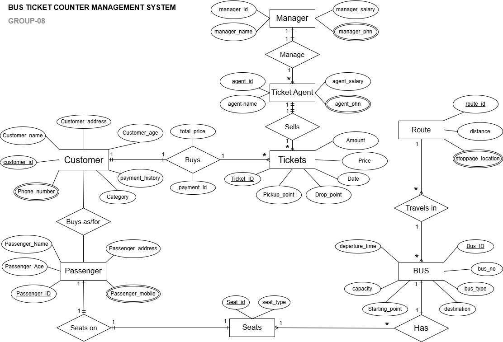
</p>

## Screenshots

Each table is shown twice: first its structure, then the data inserted into it.

### 1. Manager Table – Structure

`CREATE TABLE manager` and `DESC manager` in Oracle: columns, data types and constraints.

<p align="center">
  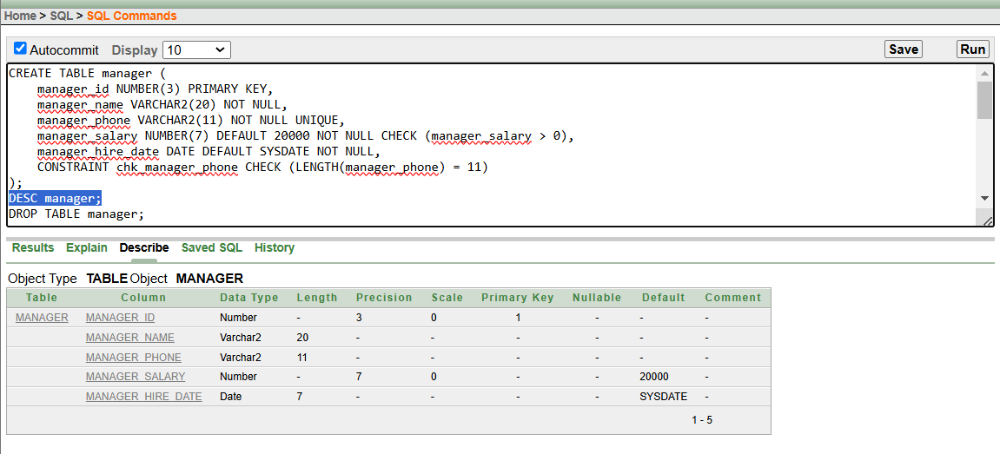
</p>

### 2. Manager Table – Inserted Data

Rows inserted into `manager` (`SELECT * FROM manager`).

<p align="center">
  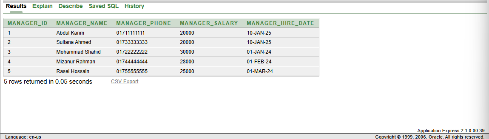
</p>

### 3. Ticket Agent Table – Structure

`CREATE TABLE ticket_agent` and `DESC ticket_agent` in Oracle: columns, data types and constraints.

<p align="center">
  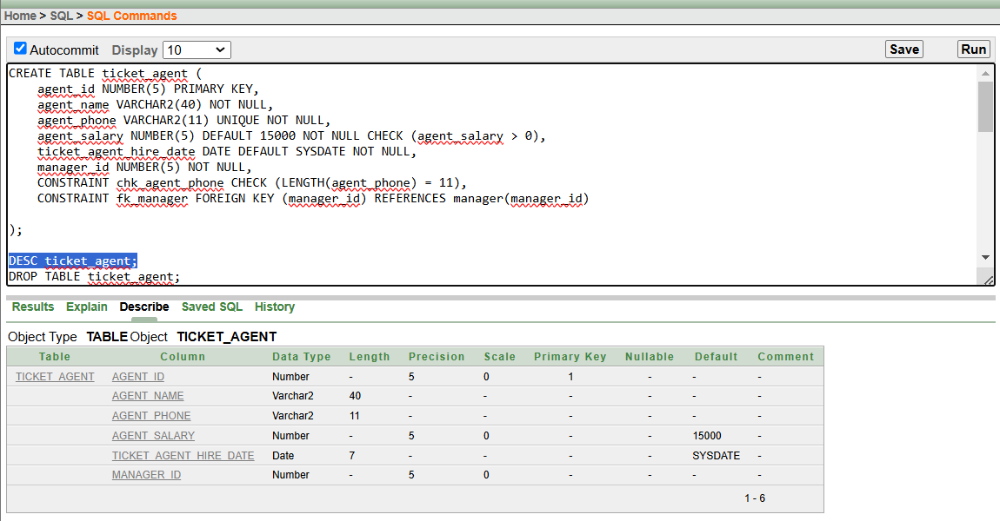
</p>

### 4. Ticket Agent Table – Inserted Data

Rows inserted into `ticket_agent` (`SELECT * FROM ticket_agent`).

<p align="center">
  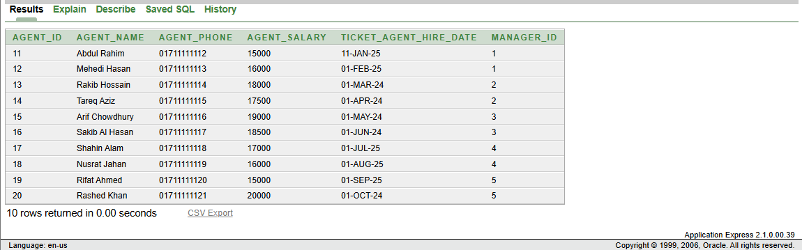
</p>

### 5. Ticket Info Table – Structure

`CREATE TABLE ticket_info` and `DESC ticket_info` in Oracle: columns, data types and constraints.

<p align="center">
  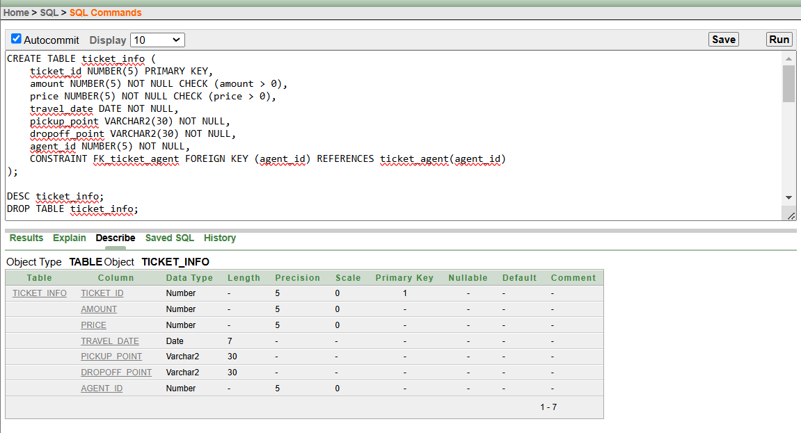
</p>

### 6. Ticket Info Table – Inserted Data

Rows inserted into `ticket_info` (`SELECT * FROM ticket_info`).

<p align="center">
  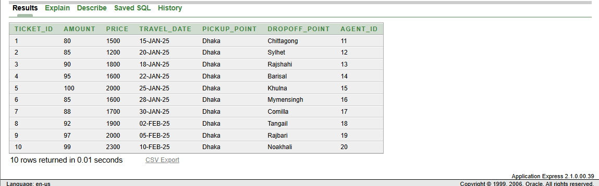
</p>

### 7. Customer Info Table – Structure

`CREATE TABLE customer_info` and `DESC customer_info` in Oracle: columns, data types and constraints.

<p align="center">
  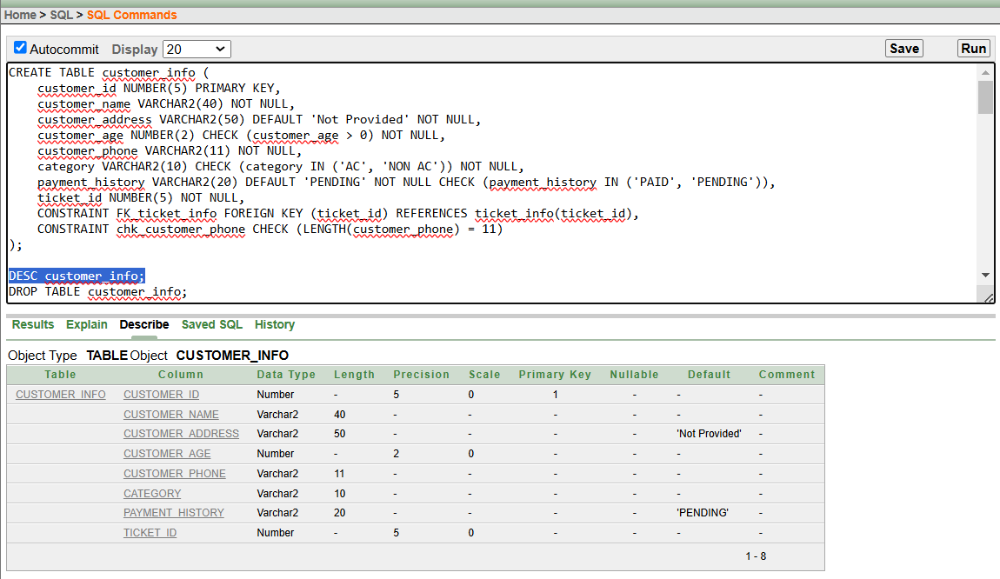
</p>

### 8. Customer Info Table – Inserted Data

Rows inserted into `customer_info` (`SELECT * FROM customer_info`).

<p align="center">
  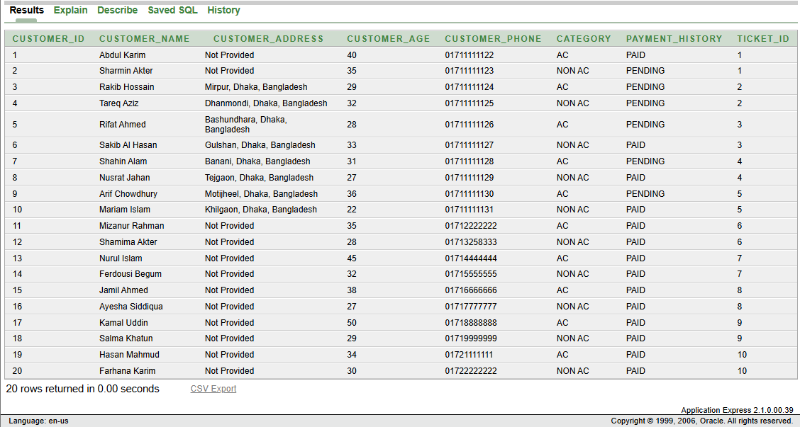
</p>

### 9. Payment Details Table – Structure

`CREATE TABLE payment_details` and `DESC payment_details` in Oracle: columns, data types and constraints.

<p align="center">
  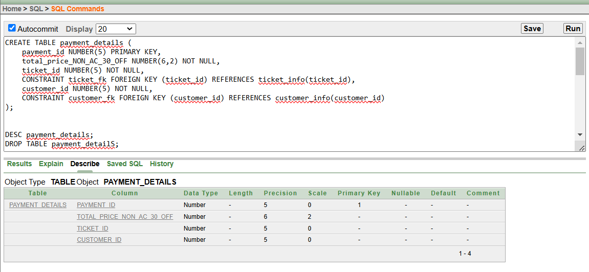
</p>

### 10. Payment Details Table – Inserted Data

Rows inserted into `payment_details` (`SELECT * FROM payment_details`).

<p align="center">
  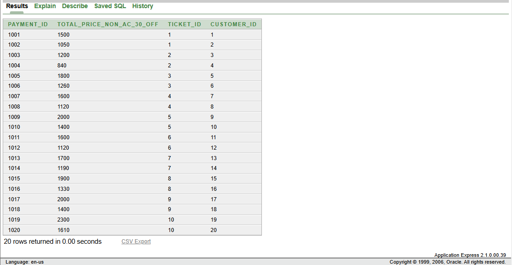
</p>

### 11. Passenger Info Table – Structure

`CREATE TABLE passenger_info` and `DESC passenger_info` in Oracle: columns, data types and constraints.

<p align="center">
  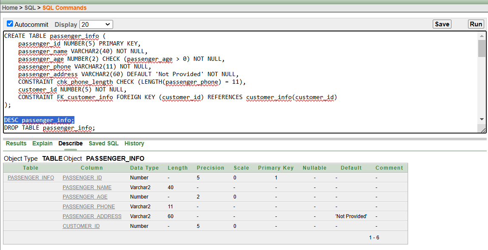
</p>

### 12. Passenger Info Table – Inserted Data

Rows inserted into `passenger_info` (`SELECT * FROM passenger_info`).

<p align="center">
  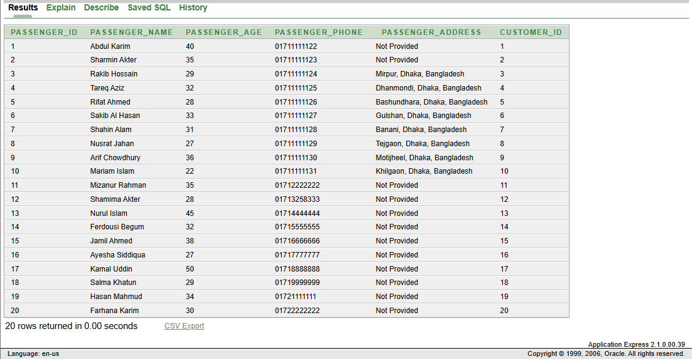
</p>

### 13. Route Table – Structure

`CREATE TABLE route` and `DESC route` in Oracle: columns, data types and constraints.

<p align="center">
  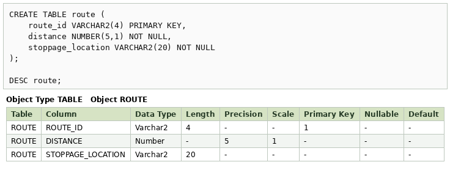
</p>

### 14. Route Table – Inserted Data

Rows inserted into `route` (`SELECT * FROM route`).

<p align="center">
  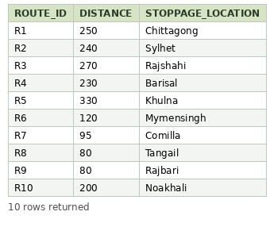
</p>

### 15. Bus Info Table – Structure

`CREATE TABLE bus_info` and `DESC bus_info` in Oracle: columns, data types and constraints.

<p align="center">
  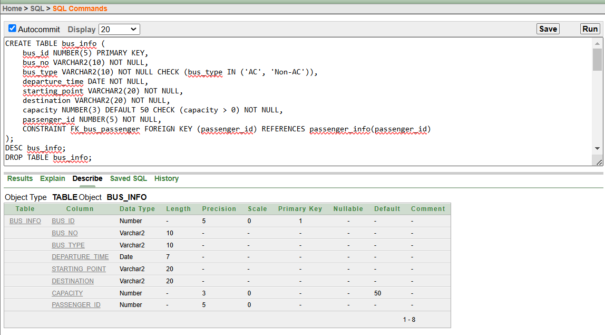
</p>

### 16. Bus Info Table – Inserted Data

Rows inserted into `bus_info` (`SELECT * FROM bus_info`).

<p align="center">
  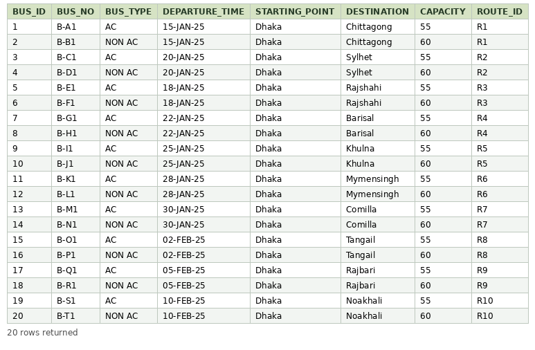
</p>

### 17. Seat Info Table – Structure

`CREATE TABLE info_seat` and `DESC info_seat` in Oracle: columns, data types and constraints.

<p align="center">
  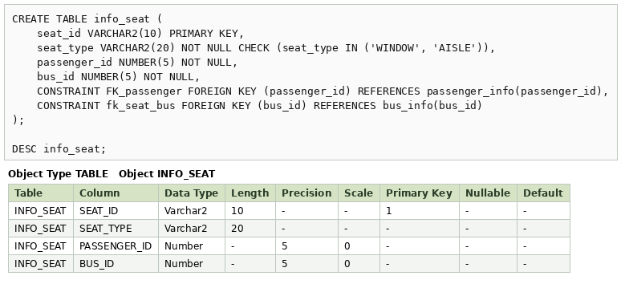
</p>

### 18. Seat Info Table – Inserted Data

Rows inserted into `info_seat` (`SELECT * FROM info_seat`).

<p align="center">
  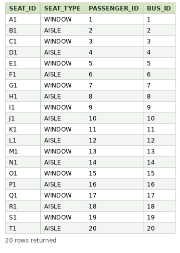
</p>

### 19. Complex View

`manager_sales_view` joins three tables and uses `GROUP BY` to show tickets sold and total sales for each manager.

<p align="center">
  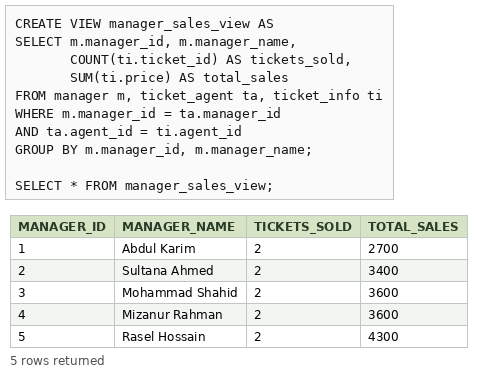
</p>

### 20. Java Connection Output

A Java program connects to the MySQL database (XAMPP) with JDBC and prints the manager table.

<p align="center">
  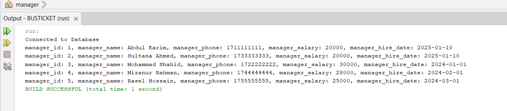
</p>
